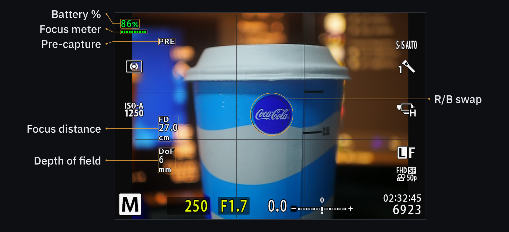
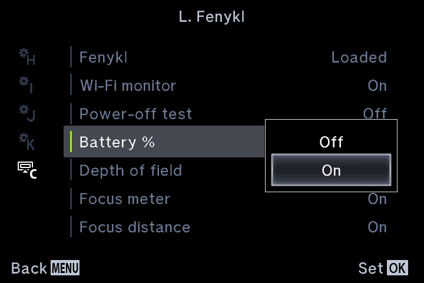
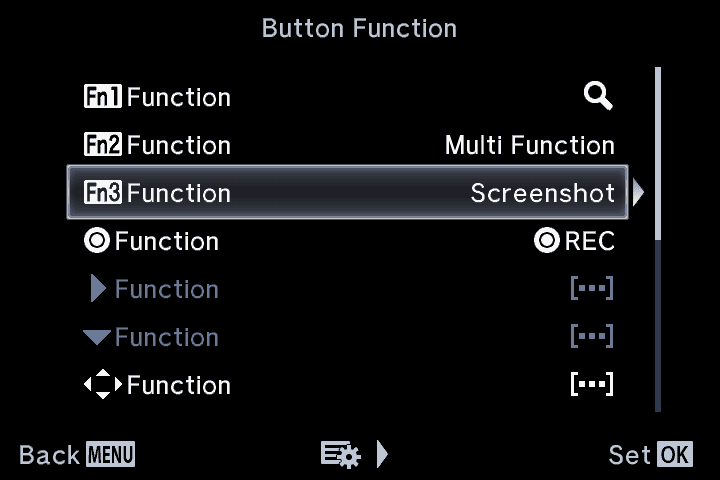
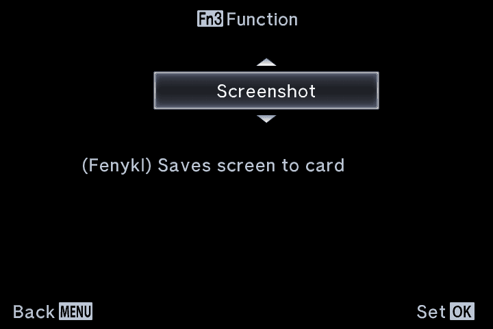

# fenykl

<p align="center">
  <em>Prometheus stole fire from the Olympians in a fennel stalk.</em>
</p>

> [!WARNING]
> Most of the code and research in this repository was produced by a liberal application of frontier LLMs. But don't worry, I was wearing my hacking bath robe I wore for many CTFs back in my day.
>
> You have been warned.


fenykl is a project providing a firmware mod infrastructure for the E-M10 Mark II. It consists of a small firmware patch that provides a mod loader to load a second stage binary from the SD card and a custom plugin infrastructure allowing plugins written in C to hook the firmware functions and alter the camera functionality. 


> [!WARNING]
> This is an early stage experimental project. I do not believe it is ready for care-free users.

## Features

<table align="center">
  <tr>
    <td><strong>Pre-capture<strong></td>
    <td>A half-press in silent sequential H mode triggers a continuous burst that keeps the latest 6 frames in memory. Fully pressing the shutter button dumps these frames onto the SD card. Needs flash off, long-exposure NR off and S-AF or MF.</td>
  </tr>
  <tr>
    <td>
      <strong>Focus distance and Depth of field readout</strong>
    </td>
    <td>The numbers that end up in EXIF get reported in the HUD too.</td>
  </tr>
  <tr>
    <td>
      <strong>Focus meter</strong>
    </td>
    <td>
      A contrast bar under the battery readout, showing how much does the AF module think it is focused.
    </td>
  </tr>
  <tr>
    <td><strong>Battery %</strong></td>
    <td>Shows a guesstimated battery precentage instead of the original stock battery icon</td>
  </tr>
  <tr>
    <td><strong>R/B swap</strong></td>
    <td>Swaps the red and blue channels (useful for IR photography)</td>
  </tr>
  <tr>
    <td><strong>Screenshot (a Button Function: assign it to Fn1, Fn2, Fn3, REC or L-Fn)</strong></td>
    <td>Saves a PPM screenshot of the live view</td>
  </tr>
</table>




## Supported cameras

The E-M10 Mark II is the primary target now.

E-PL3 support ended; its last state is on the `epl3` branch.

## How to install on the E-M10 Mark II

> [!CAUTION]
> This can potentially brick your camera. Make sure you do not care about it enough to not be sad if it gets fucked by installing random software from the internets.

You need Linux with [uv](https://docs.astral.sh/uv/) (Python 3.12+), and an E-M10 Mark II with body firmware
1.4 (Setup menu > Firmware).

Get the stock firmware `OLY_E_120_1400_0000_0000.BIN` somewhere. You can find the binaries floating on the internet in dumps 
from questionable sources, or they might be somehow extractable from the Olympus updater software. Put it into `firmware/`
in this repository.

Validate it is the correct one:

```sh
sha256sum firmware/OLY_E_120_1400_0000_0000.BIN
# ff9d302318ecf6e06c0b31c181fc6a185e93623e819749db31cec7977fa92052
```

Build the mn10300-elf cross toolchain (GCC 16.2, binutils 2.47) once.
It downloads the sources (arguments: download directory, build directory), needs a
host C/C++ compiler and make, about 3.5 GB in the build directory and about 15 minutes:

```sh
toolchain/build.sh /tmp/fenykl-dl /tmp/fenykl-build
```

This then installs the toolchain into `toolchain/install/` in the repo. 
in/README.md)).

Patch the firmware:

```sh
uv sync
uv run fenykl patch apply em10ii/fenykl-loader --output E1209999.BIN
# wrote E1209999.BIN (69599232 bytes, sha256 0c42be0e6d151e2d28c5a377574ccd182e3de4178d6e5cd8229a2f4d43859b02)
```

Flash it from the SD card:

1. Charge the battery fully. Take off the lens.
2. Format a plain SD/SDHC card in the camera.
3. Create the folder `DCOLYMP` in the card root and copy `E1209999.BIN` into it. The name must be
   exactly `DCOLYMP/E1209999.BIN`, upper case, and it must be the only `E120*.BIN` there.
4. Camera off, card in. Hold **OK** and switch the camera on. Keep holding OK until the orange lamp
   on the front lights up, then let go. The screen stays black.
5. Wait a few minutes until the lamp blinks rapidly. **Do not switch off or open the battery or
   card door while the lamp is lit.** An interrupted flash is the main way to brick the camera.
6. Switch off, delete `DCOLYMP` from the card (otherwise every power-on with OK held reinstalls it),
   switch on.

The camera now behaves like stock. Setup menu > Firmware still shows body 1.4.

To go back, flash the stock `OLY_E_120_1400_0000_0000.BIN` (or an older patched build) the same way,
renamed to `DCOLYMP/E1209999.BIN`. The OK-held update runs before the loader, so it works whatever
`FENYKL.BIN` or `FENYKL.TST` holds.

If the camera just boots into live view in step 4, the update did not start. Try once more, holding
OK firmly before switching on.

> [!CAUTION]
> **Never run a USB firmware update from a PC with `FENYKL.BIN` on the card**. 

### Building and installing the main plugin

```sh
uv run fenykl plugin build sdk/projects/main
uv run fenykl payload info sdk/projects/main/build/em10ii/FENYKL.BIN   # must end with "loader accepts"
```

Copy `sdk/projects/main/build/em10ii/FENYKL.BIN` into the **root** of the SD card.

The plugin stores its settings in `FENYKL.CF0`/`FENYKL.CF1` and writes a log to `FENYKL.LOG` in the
card root. Delete the `.CF*` files to reset the settings.

If anything goes wrong, switch off (if the camera hangs, take the battery out and set the switch Off
before you put it back: a battery inserted with the switch On runs the payload again), delete
`FENYKL.BIN` and `FENYKL.TST` from the card on a PC, and the camera boots like stock again.

When the loader runs a payload (E-M10 II):

| boot | payload |
|---|---|
| power switch On | yes |
| battery (or a switched dummy battery) connected while the switch is already On | yes, unless a USB cable is in |
| OK held at power-on (card firmware update) | no |
| USB cable plugged into the switched-off camera | no |
| battery inserted with the switch Off, card inserted | no |
| watchdog reset after a crash | no (expected, not yet measured on the camera) |

On every such boot, if `FENYKL.TST` is in the card root and no USB cable is in, the loader reads it,
deletes it from the card and only then checks and runs it. A test build copied there therefore runs
exactly once; when it is missing or broken (bad header or checksum) the loader runs `FENYKL.BIN`
instead, and the next boot runs `FENYKL.BIN` again. With a cable in, a power-switch boot runs only
`FENYKL.BIN` and leaves `FENYKL.TST` alone.

## Settings

To configure fenykl and verify that it got loaded, go into MENU > Custom menu: below K there is a
tab **L. Fenykl**. Its first row reads **Fenykl Loaded**; every other row is one setting, edited
like any stock Custom menu row (OK, pick a value, OK).



A changed setting takes effect at once and is saved two seconds later.

### Screenshot on a button

The screenshot is a Button Function of its own: MENU > Custom menu > B > Button Function, pick
Fn1, Fn2, Fn3, REC or L-Fn and choose **Screenshot** (its help line starts with "(Fenykl)"). A
press of that button saves `SHOTnnnn.PPM` to the card root. Without fenykl loaded the button does
nothing.



