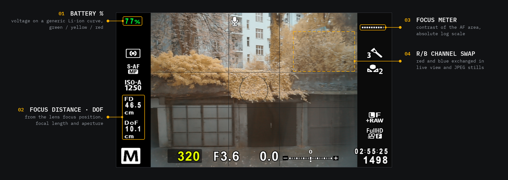

# fenykl

fenykl adds features to the Olympus E-PL3. It patches the stock firmware v1.6 with a small boot
loader, which then runs a plugin, `FENYKL.BIN`, from the SD card at every power-on. The firmware is
flashed once. After that, a plugin is just a file on the card.

**Disclaimer.** Flashing modified firmware may brick your camera. There is no warranty of any kind,
you do this at your own risk. fenykl is not affiliated with or endorsed by OM Digital Solutions or
Olympus.

## Features

All of these run on a real E-PL3.

- **Plugin loader.** Without `FENYKL.BIN` on the card the camera behaves like stock. A plugin does not
  start when the camera is switched on by plugging in the USB cable.
- **Focus distance** of the lens in live view, below the ISO item of the left info column.
- **Depth of field**, the distance between the near and the far limit (`inf` once the far limit is
  infinite), from the focus distance, the focal length and the set aperture. Circle of confusion 15 µm.
- Both are drawn in the camera's own font, as narrow as the stock info items, on the info screens
  Basic, Histogram and Highlight&Shadow. They are hidden without a lens.
- **Battery percentage** (option `main.batt.show`, on by default) in the top-left corner of the same
  info screens, e.g. `73%`: green above 50 %, yellow above 25 %, red below. It comes from the
  battery voltage, read once a second as the camera's own battery check reads it, filtered over
  about 10 s and mapped through a generic Li-ion curve (not yet calibrated on the camera beyond one
  voltage). Hidden on the AC adapter or DC coupler. The stock battery icon stays as it is: the
  camera shows it on these screens only when the battery is low.
- **Focus meter**: ten cells in the stock exposure-scale look under the green AF dot, showing the AF
  contrast of the active AF area on an absolute logarithmic scale (MF: not yet run on the camera).
- **Fn screenshot** (option): a short Fn press in live view saves the panel, live view and info
  items, as `C:\SHOTnnnn.PPM`; a long press keeps the stock Fn function.
- **R/B swap** (option): red and blue swapped in live view and JPEG stills, in every white balance.
- **Settings page** in the camera menu, looking like a stock menu page: focus distance, depth of
  field, focus meter and battery percentage on/off, Fn override, R/B swap, log level.
- **C plugin SDK** for writing your own plugins, and the firmware CLI: [sdk/README.md](sdk/README.md).



The probe and example plugins in [sdk/projects/README.md](sdk/projects/README.md) are experiments,
not features.

## Building and flashing the loader

You need Linux with [uv](https://docs.astral.sh/uv/) (Python 3.12+), and an E-PL3 with body firmware
1.6 (Setup menu > Firmware).

Get the stock firmware `OLY_E_086_1600_0000_0000.BIN` yourself. It is the file the Olympus updater
downloads for the E-PL3, and it is copyrighted, so it is not included here. Put it into `firmware/`
(the `.BIN.lzma` the updater stores works too) and check it:

```sh
sha256sum firmware/OLY_E_086_1600_0000_0000.BIN
# 89b70dd65c6739de1cd762777205953ee15864df73369b84815df7ed8a0eb4b1
```

This is the sha256 of the decompressed `.BIN`, from the `[stock]` table of
`sdk/targets/epl3/target.toml`. fenykl refuses any other image.

Build the mn10300-elf cross toolchain (GCC 16.2, binutils 2.47) once. The loader does not need it,
plugins do. It downloads the sources (arguments: download directory, build directory), needs a
host C/C++ compiler and make, about 3.5 GB in the build directory and about 15 minutes:

```sh
toolchain/build.sh /tmp/fenykl-dl /tmp/fenykl-build
```

It installs into `toolchain/install/`. To use a toolchain installed elsewhere, set
`FENYKL_TOOLCHAIN` to its prefix (details: [toolchain/README.md](toolchain/README.md)).

Patch the firmware:

```sh
uv sync
uv run fenykl patch apply epl3/fenykl-loader --output E0869999.BIN
# wrote E0869999.BIN (46596160 bytes, sha256 ac1db3e8cc54a1f41c4daba261a5058c228f94640548a53ba4be7d93ad509c32)
```

If the stock image is somewhere else, pass it with `--input STOCK.BIN`.

Flash it from the SD card:

1. Charge the battery fully. Take off the lens and anything on the accessory port.
2. Format a plain SD/SDHC card in the camera (no Eye-Fi or other Wi-Fi card).
3. Create the folder `DCOLYMP` in the card root and copy `E0869999.BIN` into it. The name must be
   exactly `DCOLYMP/E0869999.BIN`, upper case, and it must be the only `E086*.BIN` there.
4. Camera off, card in. Hold **OK** and switch the camera on. Keep holding OK until the orange lamp
   on the front lights up, then let go. The screen stays black.
5. Wait a few minutes until the lamp blinks rapidly. **Do not switch off or open the battery or
   card door while the lamp is lit.** An interrupted flash is the main way to brick the camera.
6. Switch off, delete `DCOLYMP` from the card (otherwise every power-on with OK held reinstalls it),
   switch on.

The camera now behaves like stock. Setup menu > Firmware still shows body 1.6.

If the camera just boots into live view in step 4, the update did not start. Try once more, holding
OK firmly before switching on. Do not try other key combinations.

To go back to stock, flash the stock `OLY_E_086_1600_0000_0000.BIN` the same way, renamed to
`DCOLYMP/E0869999.BIN` (decompress a `.BIN.lzma` first with `xz -dc --format=lzma`).

**Never run a USB firmware update from a PC with `FENYKL.BIN` on the card.** The plugin would be
running while the flash is written. Remove the card first.

## Building and installing the main plugin

```sh
uv run fenykl plugin build sdk/projects/main
uv run fenykl payload info sdk/projects/main/build/epl3/FENYKL.BIN   # must end with "loader accepts"
```

This needs the cross toolchain, nothing else. `plugin build --isa-check` adds an optional ISA check
that needs Ghidra with an MN10300 extension, which is not part of this repository; no step here needs it.

Copy `sdk/projects/main/build/epl3/FENYKL.BIN` into the **root** of the card, not into `DCOLYMP/`.
The card must not hold `DCOLYMP/E0869999.BIN`. Switch the camera on normally, without holding OK.

The plugin stores its settings in `FENYKL.CF0`/`FENYKL.CF1` and writes a log to `FENYKL.LOG` in the
card root. Delete the `.CF*` files to reset the settings.

If anything goes wrong, switch off (take the battery out if the camera hangs), delete `FENYKL.BIN`
from the card on a PC, and the camera boots like stock again.

## Settings page

MENU > Custom menu, tab **J** > last row **Fenykl**, then OK. If the Custom menu is missing, turn it on
in Setup menu > Menu Display.

<!-- screenshot: Custom menu tab J with the Fenykl row -->
<!-- screenshot: Fenykl settings page -->

A changed setting takes effect at once and is saved two seconds later.
